<p align="center">
  
</p>

<h3 align="center">Hi, I'm Hassan 👋 I make pixels behave.</h3>

<p align="center">
  
</p>

<p align="center">
  
  
  
  
  
</p>

---

### 📦 `package.json` (of me)

```json
{
  "name": "hassan",
  "version": "4.2.0-coffee.3",
  "description": "Turns Figma files into things that actually work on mobile",
  "main": "src/brain/index.tsx",
  "scripts": {
    "start": "coffee && npm run dev",
    "test": "it works on my machine",
    "deploy": "pray && git push"
  },
  "dependencies": {
    "react": "^19.0.0",
    "next": "latest-that-doesnt-break",
    "typescript": "strict-ish",
    "coffee": "*"
  },
  "peerDependencies": {
    "sleep": "optional"
  }
}
```

---

### 🧰 What's in the toolbox

<p align="center">
  
</p>

---

### 🎨 Me, written in CSS

```css
.hassan {
  display: flex;               /* adapts to any team */
  justify-content: center;     /* eventually */
  gap: 1rem;                   /* between me and my inbox */
  transition: all 300ms ease;  /* deadlines feel smoother this way */
  overflow: hidden;            /* bugs exist, you just can't see them */
  z-index: 9999;               /* ended up on top of every project somehow */
}

@media (max-width: 4am) {
  .hassan { opacity: 0.4; }    /* still typing, mostly just vibes */
}
```

---

### 🔦 Lighthouse report (of me)

| Metric | Score | Notes |
| --- | :---: | --- |
| ⚡ Performance | 🟠 **38** → 🟢 **97** | Score shown before → after coffee |
| ♿ Accessibility | 🟢 **100** | Every button has a label. My feelings don't. |
| 🧹 Best practices | 🟢 **92** | Lost 8 points for a `// TODO: fix later` from 2023 |
| 🎯 Focus | 🟡 **61** | Had 46 tabs open during the audit |
| 😴 Sleep | ⚪ **N/A** | `<Suspense fallback={<Coffee />}>` |

---

### 💬 Designer ↔ me

> **🎨 Designer:** can we make it pop more?<br>
> **👨‍💻 Me:** what does pop mean in pixels<br>
> **🎨 Designer:** you'll know it when you see it<br>
> **👨‍💻 Me:** *adds `box-shadow`*<br>
> **🎨 Designer:** perfect, now make it subtle

---

### 🔮 Today's `console.warn`

<!-- EXCUSE:START -->
> [!WARNING]
> **Today's excuse:** "Clear your cache and try again."
<!-- EXCUSE:END -->

<sub>A GitHub Action rerolls this every morning, so CI takes the blame, not me.</sub>

---

### 🐍 A snake is eating my green squares

<p align="center">
  <picture>
    <source media="(prefers-color-scheme: dark)" srcset="https://raw.githubusercontent.com/hassan-oraclaim/hassan-oraclaim/output/github-snake-dark.svg" />
    <source media="(prefers-color-scheme: light)" srcset="https://raw.githubusercontent.com/hassan-oraclaim/hassan-oraclaim/output/github-snake.svg" />
    
  </picture>
</p>

<p align="center">
  
</p>

---

<p align="center">
  <a href="mailto:hassan@oraclaim.com"></a>
  <br/>
  <sub>*INP target. Real replies are cached until after standup.</sub>
</p>

<p align="center"><sub>Built with semantic HTML, questionable CSS and zero layout shift. Probably.</sub></p>
